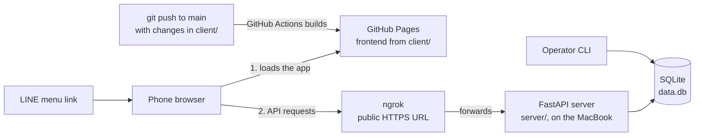
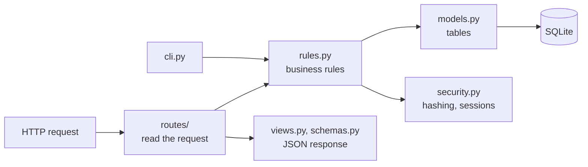

# Store Referral App

A web app for store referrals. Customers get coupons at a store or through a friend's referral code, use them at the store, and the referrer earns a reward coupon. Each redemption records a platform fee and a charity contribution. Domain terms are defined in [GLOSSARY.md](GLOSSARY.md).

- `client/`: React + Vite + Tailwind (JavaScript), deployed to GitHub Pages.
- `server/`: FastAPI + SQLite (Python, managed with [uv](https://docs.astral.sh/uv/)), run locally and exposed with ngrok.

## Architecture



The frontend is static files on GitHub Pages and stays online. The server and database run on the MacBook, and ngrok gives them a public HTTPS address while they are running. Pushing changes in `client/` to `main` rebuilds the live frontend; server changes take effect when the server restarts.

Inside the server, a request flows left to right:



## Run locally

```bash
cd server
uv sync
uv run python -m app.cli create-store TEST "Test Store" --charity "Test Charity" --password test123
uv run uvicorn app.main:app --port 8000
```

```bash
cd client
npm install
npm run dev        # http://localhost:5173
```

The client calls `http://localhost:8000` unless `VITE_API_URL` is set (see `client/.env.example`).

## Deploy

1. Expose the server with ngrok, allowing the Pages origin:

   ```bash
   CLIENT_ORIGINS=https://<github-user>.github.io uv run uvicorn app.main:app --port 8000
   ngrok http 8000 --url https://<your-domain>.ngrok-free.dev
   ```

2. In the GitHub repo, set *Settings → Pages → Source* to **GitHub Actions** and add the Actions variable `API_URL` with the ngrok URL. Pushes to `main` that touch `client/` deploy it.

3. Link pages from elsewhere (e.g. a LINE official account menu) with hash routes: `#/claim`, `#/wallet`, `#/referral`, `#/charity`, `#/about`, `#/join`, `#/store`.

## Stores

```bash
cd server
uv run python -m app.cli create-store CODE "Store Name" --charity "Charity Name"   # prints a one-time setup code
uv run python -m app.cli list-stores
uv run python -m app.cli reset-store CODE                                          # new setup code, signs the store out
```

The store owner enters the setup code on the store page (`#/store`) and chooses a password. `--password` skips this step and is for test stores only.

The server does not migrate existing tables; after a schema change, delete `server/data.db` and recreate the stores.

## Checks

```bash
cd server && uv run pytest && uv run ruff check .
cd client && npm run lint && npm run build
```

Manual test steps are in [docs/manual-tests.md](docs/manual-tests.md).
